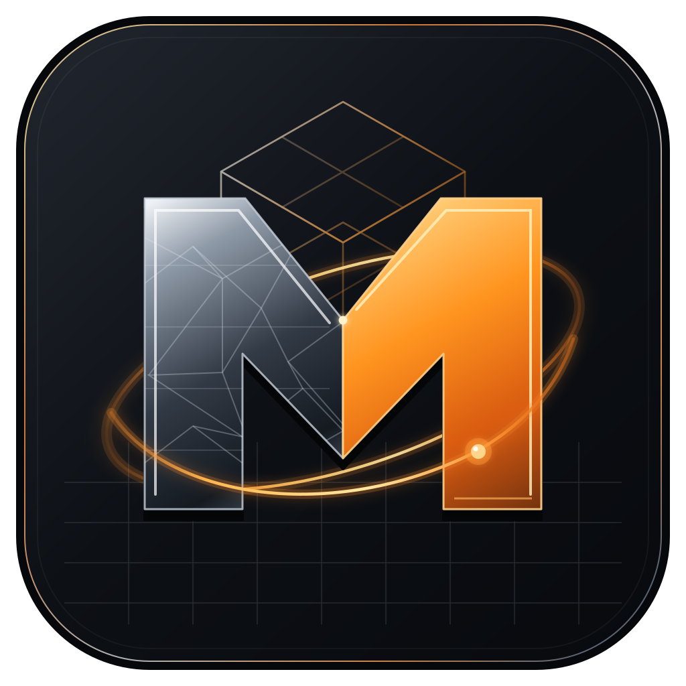
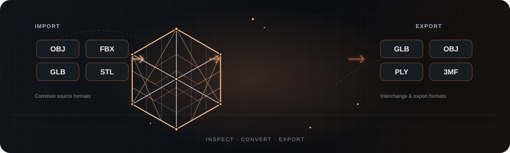
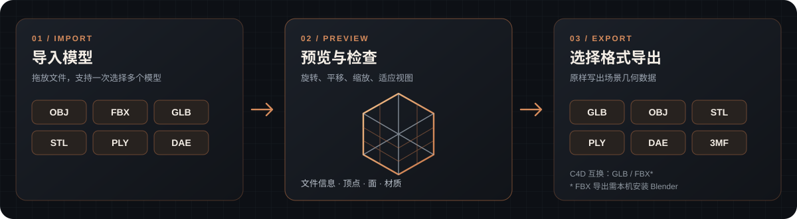
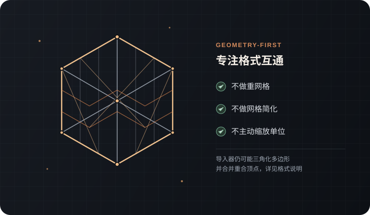

<div align="center">
  
  <h1>Meshora</h1>
  <p><strong>一键转换 · 预览即所得</strong></p>
  <p>一款专注于 3D 模型格式互通的 Windows 桌面工具。拖入模型、实时预览、检查网格信息，再导出为常见格式。</p>
  <p>
    <a href="https://github.com/MarsBaseX1/meshora/releases/latest"></a>
    <a href="https://github.com/MarsBaseX1/meshora/releases"></a>
    <a href="https://github.com/MarsBaseX1/meshora"></a>
    <a href="https://github.com/MarsBaseX1/meshora"></a>
    <a href="https://github.com/MarsBaseX1/meshora/actions/workflows/build-windows.yml"></a>
    
  </p>
  <p>
    <a href="https://github.com/MarsBaseX1/meshora/releases/latest"><strong>下载最新版本</strong></a>
    &nbsp;·&nbsp;
    <a href="https://github.com/MarsBaseX1/meshora/releases">所有版本</a>
    &nbsp;·&nbsp;
    <a href="https://github.com/MarsBaseX1/meshora/issues">反馈问题</a>
  </p>
  
</div>

---

## Meshora 是什么？

Meshora 帮你把分散在不同 3D 工具和文件格式之间的模型工作流，整理成一个简单的桌面流程：**导入 → 预览 → 检查 → 导出**。

它适合需要快速查看模型、确认基础网格信息、在常见格式之间传递资产的设计师、开发者和 3D 内容创作者。Meshora 专注于格式转换与预览，不试图替代 Blender、Cinema 4D 或专业网格编辑软件。

## 核心工作流

<table>
  <tbody>
    <tr>
      <td width="56%" valign="middle">
        
      </td>
      <td width="44%" valign="middle">
        <h3>01 · 导入、预览、导出</h3>
        <p>将一个或多个模型拖入窗口，直接在 3D 视口中检查，再选择目标格式导出。</p>
        <ul>
          <li>实时旋转、平移、缩放与适应视图</li>
          <li>网格、线框和自动旋转视图选项</li>
          <li>查看文件格式、顶点、面、文件大小与材质等信息</li>
          <li>支持多文件选择与批量导出</li>
        </ul>
      </td>
    </tr>
    <tr>
      <td width="44%" valign="middle">
        <h3>02 · 专注几何数据互通</h3>
        <p>Meshora 默认不进行重网格、网格简化或单位缩放，帮助你在格式转换时减少不必要的几何处理。</p>
        <ul>
          <li>适合快速转换与资产交接</li>
          <li>可选用本机 Blender 作为额外格式桥接</li>
          <li>转换细节与格式限制在下方明确列出</li>
        </ul>
      </td>
      <td width="56%" valign="middle">
        
      </td>
    </tr>
  </tbody>
</table>

## 主要功能

<table>
  <tbody>
    <tr>
      <td width="50%" valign="top">
        <h3>实时 3D 预览</h3>
        <p>使用 three.js 显示导入后的场景，可旋转、平移、缩放、适应视图，并切换网格、线框与自动旋转。</p>
      </td>
      <td width="50%" valign="top">
        <h3>批量文件工作流</h3>
        <p>一次拖入或选择多个模型，快速浏览文件信息，并将选中的场景批量导出到目标格式。</p>
      </td>
    </tr>
    <tr>
      <td width="50%" valign="top">
        <h3>Blender 桥接</h3>
        <p>可选连接本机 Blender CLI，用于预览 <code>.blend</code> 文件，以及将模型转换为 Cinema 4D 可用的 FBX。</p>
      </td>
      <td width="50%" valign="top">
        <h3>Cinema 4D 互换导出</h3>
        <p>提供 <code>C4D · GLB</code> 与 <code>C4D · FBX</code> 互换文件选项，便于将模型交给 Cinema 4D 继续处理。</p>
      </td>
    </tr>
  </tbody>
</table>

## 格式支持

| 工作流 | 格式 | 说明 |
| --- | --- | --- |
| 常见导入 | OBJ、FBX、GLTF、GLB、STL、PLY、DAE、3DS、3MF、OFF、X | 也包含其他由当前 Assimp/WASM 读取器支持的格式 |
| 常见导出 | GLB、GLTF、OBJ、STL、PLY、DAE、3MF | GLB / GLTF 使用 glTF 2.0 导出；STL 支持二进制与文本形式 |
| Cinema 4D 互换 | GLB、FBX | 输出的是 Cinema 4D 可打开的互换文件，不是原生 `.c4d` 工程 |
| 可选外部桥接 | BLEND、FBX | 需要在本机安装并配置 Blender；FBX 导出依赖 Blender |

### 转换行为与限制

- **不做重网格、简化或单位缩放。** 但导入器会在导入阶段三角化多边形，并可能合并重合顶点；这属于底层 Assimp/WASM 读取流程。
- STL 与 3MF 需要三角面，Meshora 会按导入后的场景数据导出。
- `.blend` 需要安装 Blender，并在「设置」中确认程序路径。
- `.max` 无法在没有 3ds Max 的情况下直接解析。请先在 3ds Max 中导出为 FBX，再导入 Meshora。
- USD / USDZ 等格式的实际读取能力取决于当前 WASM 构建包含的读取器；若读取器未编译，文件可能无法导入。
- Cinema 4D 导出只提供 GLB / FBX 互换格式，**不会生成原生 `.c4d` 工程文件**。

## 快速开始

### 方式一：下载 Windows 安装包

1. 打开 [GitHub Releases](https://github.com/MarsBaseX1/meshora/releases/latest)。
2. 下载最新的 `Meshora-Setup-*.exe` 并运行安装程序。
3. 启动 Meshora，将模型拖入窗口，选择目标格式后导出。

如果需要 `.blend` 预览或 FBX 桥接，请另外安装 [Blender](https://www.blender.org/)。

### 方式二：从源码运行

需要 **Node.js 20+**。

```bash
npm install
npm run start
```

开发模式下先启动 Vite：

```bash
npm run dev
```

然后在另一个终端启动 Electron（Windows PowerShell）：

```powershell
$env:ELECTRON_START_URL="http://localhost:5173"
npx electron .
```

### 构建 Windows 安装包

在 Windows 环境中执行：

```bash
npm run build:win:nsis
```

构建产物位于 `release-build/`。项目的 GitHub Actions 会在 Pull Request 中验证 Windows 安装包，并在版本提交合并到 `main` 后自动构建、发布对应版本的 GitHub Release。

## 技术栈

- **桌面应用：** Electron
- **构建工具：** Vite
- **3D 视口：** three.js
- **格式读取与转换：** assimpjs / WebAssembly
- **可选格式桥接：** Blender CLI

## Code signing policy（代码签名政策）

Meshora 正在准备接入 SignPath Foundation。**在项目获批、签名配置完成，并且对应发布页明确标注签名状态之前，Windows 下载均应视为未签名。**

获批并启用后，签名安装包将使用以下署名：

> Free code signing provided by SignPath.io, certificate by SignPath Foundation.

- [查看完整 Code signing policy](CODE_SIGNING.md)
- [MIT License](LICENSE)
- [SignPath Foundation 申请与资格说明](https://signpath.org/)

当前自动化流程计划先签名 Windows 安装程序；便携 ZIP 暂不纳入此轮签名范围。SignPath Foundation 对每次发布的签名请求仍要求人工审批。

## 反馈与参与

遇到无法导入的模型、转换异常或有功能建议？欢迎通过 [GitHub Issues](https://github.com/MarsBaseX1/meshora/issues) 提交问题，并尽可能附上源文件格式、目标格式与复现步骤。

---

<div align="center">
  <sub>Meshora · 一键转换，预览即所得</sub>
  <br />
  <sub>Copyright © 2026 marsbasex.com</sub>
</div>
